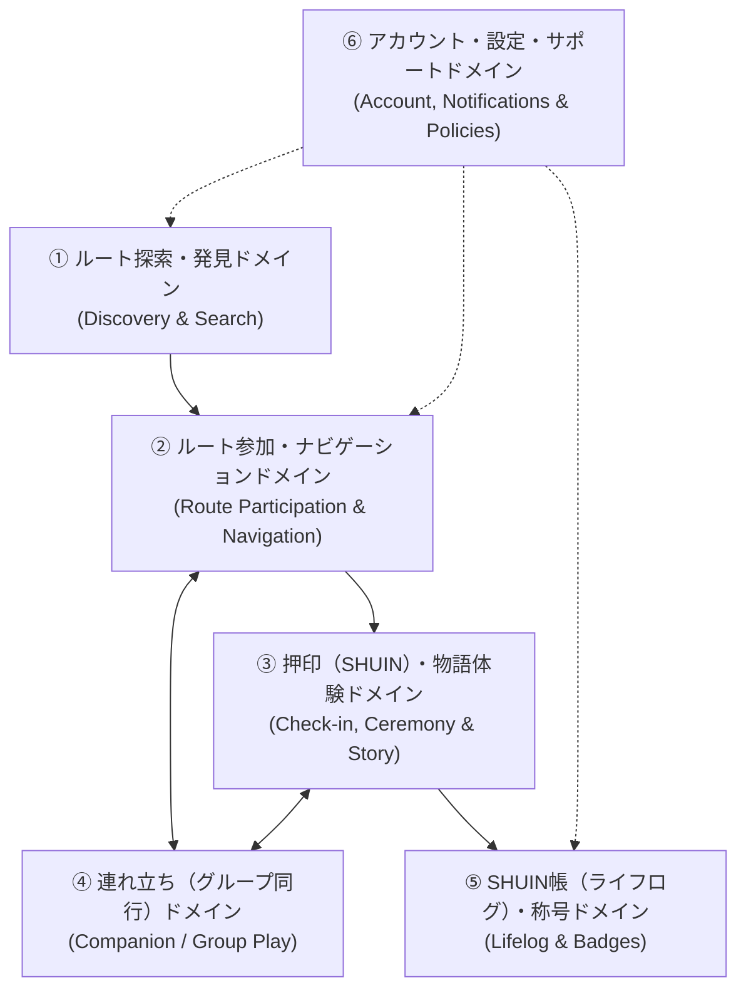

# SHUIN（まちのしるし）サイト調査レポート・ドメイン定義書

本ドキュメントは、現在のリポジトリ（Next.js App Router + Supabase 構成）のソースコードを調査し、**① 全ページ一覧と機能ごとの状態（実装ステータス・状態遷移）**、**② ドメイン分類**、**③ ユーザーマニュアルおよびFAQナレッジの章立て構成** を整理したナレッジベースです。

関連ドキュメント：
- [ユーザーマニュアル本編 (`user_manual.md`)](./user_manual.md)
- [サイトFAQナレッジ集 (`faq_knowledge.md`)](./faq_knowledge.md)

---

## 1. ページ一覧と機能・状態確認マトリクス

現在の `src/app/` 配下に実装されている全17ルート（画面16＋API 1）の一覧と、各機能の実装状態・状態分岐の確認結果です。

### 1-1. 画面（ページ）一覧

| パス | 画面名 | 対象ファイル | 認証要否 | 主な役割・機能 | 実装状態 |
| :--- | :--- | :--- | :--- | :--- | :--- |
| `/` | トップページ（ホーム） | `src/app/page.tsx` | ゲスト可 | 初回スプラッシュ演出、地図検索・条件検索への導線、公開中ルート一覧の表示 | ✅ 稼働中 |
| `/routes` | ルート一覧・検索結果 | `src/app/routes/page.tsx` | ゲスト可 | 都道府県・カテゴリ（10種）・予算（3段階）による絞り込み結果表示 | ✅ 稼働中 |
| `/map` | 地図から探す（全体マップ） | `src/app/map/page.tsx` | ゲスト可 | 現在地周辺のルートをカテゴリ別ピンで表示、タップで経路描画アニメ＆概要モーダル表示 | ✅ 稼働中 |
| `/routes/[id]` | ルート詳細画面 | `src/app/routes/[id]/page.tsx` | ゲスト可（一部要認証） | ルート概要、参加/再参加、連れ立ち開始/管理、獲得しるし帳、スポット一覧、授かる踏破印の予告 | ✅ 稼働中 |
| `/routes/[id]/destinations` | 次の行き先選択画面 | `src/app/routes/[id]/destinations/page.tsx` | 要ログイン | ルート参加直後などに、目指すスポット（`active_spot_id`）を選択してマップへ遷移 | ✅ 稼働中 |
| `/routes/[id]/map` | ルートプレイ中マップ画面 | `src/app/routes/[id]/map/page.tsx` | ゲスト可（基本は参加中） | スポット間の軌跡、現在地から目的地へのナビ矢印と残り距離、同行メンバー位置・リアルタイム通知 | ✅ 稼働中 |
| `/routes/[id]/spot/[spotId]` | スポット詳細・押印画面 | `src/app/routes/[id]/spot/[spotId]/page.tsx` | ゲスト閲覧可 / 押印は要認証 | 接近Actバナー（300m/100m/50m）、GPS/QR押印、押印儀式（F4〜F9）、思い出写真・メモ記録、自答の儀、完走演出（C1〜C4）、SNSカード画像シェア | ✅ 稼働中 |
| `/triggers/[token]` | 現地QRトリガー（物語の入口） | `src/app/triggers/[token]/page.tsx` | ゲスト可（参加時要認証） | 街角のQRからプロローグ（Act 0）を紙芝居風に再生し、そのままルート参加＆第1スポットを目的地設定 | ✅ 稼働中 |
| `/groups/[groupId]` | 連れ立ち待機ルーム | `src/app/groups/[groupId]/page.tsx` | 要ログイン | 招待コード表示、同行メンバー一覧確認（現在はアクセス時にプレイマップへ自動合流リダイレクト） | ✅ 稼働中（自動転送） |
| `/login` | ログイン画面 | `src/app/login/page.tsx` | ゲスト専用 | Googleアカウント（OAuth）によるワンタップログイン・新規登録（`redirect` パラメータ対応） | ✅ 稼働中 |
| `/mypage` | マイページ（ダッシュボード） | `src/app/mypage/page.tsx` | 要ログイン | プロフィール、連れ立ち招待コード入力、街の便り、進行中ルート、獲得称号（新着バッジ通知）、最近の来訪日記、保存したルート | ✅ 稼働中 |
| `/mypage/active` | 進行中のルート一覧 | `src/app/mypage/active/page.tsx` | 要ログイン | 現在進行中のルート進捗確認、残り有効時間（24時間）表示、再開、進行中からの解除 | ✅ 稼働中 |
| `/mypage/diary` | SHUIN帳（来訪日記・履歴） | `src/app/mypage/diary/page.tsx` | 要ログイン | 生涯/月別の押印数・完走ルート数集計、参加ルート一覧モーダル、ルートの踏破印（メイン＋サブ）、スポット来訪印グリッド、写真・メモ・同行者振り返り | ✅ 稼働中 |
| `/mypage/bookmarks` | 保存したルート一覧 | `src/app/mypage/bookmarks/page.tsx` | 要ログイン | 保存（ブックマーク）したルートの一覧表示と詳細への遷移 | ⚠️ 表示のみ（登録UI未接続） |
| `/badges` | 称号一覧・授与画面 | `src/app/badges/page.tsx` | 要ログイン | 未開封称号の「称号授与の儀（封印開封）」、6カテゴリ別・15段階レベル称号の一覧、レア度・取得状態フィルタ | ✅ 稼働中 |
| `/notifications` | 街の便り（お知らせ） | `src/app/notifications/page.tsx` | ゲスト可 | 新ルート・機能更新・季節イベントのお知らせ一覧（アコーディオン展開） | ✅ 稼働中（静的データ） |
| `/settings` | 設定画面 | `src/app/settings/page.tsx` | 要ログイン | アカウント情報確認、プッシュ通知トグル、利用規約・プライバシーポリシーリンク、ログアウト、退会案内 | ✅ 稼働中（通知配信は準備中） |
| `/terms` | 利用規約 | `src/app/terms/page.tsx` | ゲスト可 | サービス利用規約の表示 | ✅ 稼働中 |
| `/privacy` | プライバシーポリシー | `src/app/privacy/page.tsx` | ゲスト可 | 個人情報保護方針の表示 | ✅ 稼働中 |
| `/api/keep-alive` | DBキープアライブAPI | `src/app/api/keep-alive/route.ts` | システム用 | Supabaseの休止防止用ヘルスチェックエンドポイント | ✅ 稼働中 |

---

### 1-2. 機能ごとの詳細な状態（ステート）確認

コード調査により判明した、各機能における重要な状態遷移・仕様および一部未実装（今後の拡張予定）箇所の整理です。

1. **ルートの参加状態（`user_routes.status` と 24時間ルール）**
   - **未参加**: 「このルートに参加する」（未ログイン時は「ログインしてこのルートに参加する」）を表示。
   - **進行中（`IN_PROGRESS` かつ参加から24時間以内）**:
     - 同時に「進行中」にできるルートは **最大1本まで**。別ルートが進行中の状態で新しいルートに参加しようとすると、切り替え確認モーダルが表示される（切り替えても過去の押印や履歴は消えない）。
     - 参加（または再参加）から **24時間** が経過すると自動的に進行中状態から外れ、完走済みなら `COMPLETED`、未完走なら `CANCELED` に遷移する。
   - **再参加（過去に参加または押印履歴あり）**:
     - 「このルートに再参加する」ボタンが表示され、押下すると再び24時間「進行中」に設定される。
   - **完走（`COMPLETED`）**:
     - ルート内の全スポットで押印を完了すると自動的に `COMPLETED` となる。

2. **スポットの目的地設定（`users.active_spot_id`）と押印状態（`useSpotStampStatus`）**
   - **目的地未設定 / 設定済み**: 参加中のルート詳細または行き先選択画面で「ここを目的地にする」を押すと、スポットカードに「目的地」の朱印マークが重なり、マップ上で現在地から目的地への朱色ナビゲーション矢印と残り距離が表示される。
   - **未押印（圏外 / 圏内）**:
     - スポットからの距離に応じて **300m（幕・壱）→ 100m（幕・弐）→ 50m（幕・終）** の3段階で「接近物語バナー」が自動表示される。
     - 原則 **半径50m以内**（スポット個別の `radius_meters` 設定がある場合はその距離以内）に入ると「圏内です。押印できます。」と表示され、「押印する」ボタン（および `qr_token` 設定時は「QRコードで押印する」ボタン）が有効化される。
   - **本日押印済み（`isTodayStamped = true`）**:
     - 日本時間（JST）基準で同日中に押印済みの場合は、重複押印を防ぎ「🎉 本日のしるしを刻みました」カードが表示される。
     - 当日中は何度でも「💮 セレモニーを再体験する」ボタンから押印演出を再生できるほか、感想メモや写真の追加・送信が可能。
   - **過去に押印済み・別日に再訪（`isAcquired = true` かつ `isTodayStamped = false`）**:
     - 「しるし獲得済み（来訪 N回目）」バッジが表示され、再訪として再び押印が可能。押印儀式では「おかえりなさい。再びこの地へ」という再訪専用メッセージに変化する。

3. **押印セレモニーとルート完走・自答の儀（`CeremonyStep`）**
   - **押印儀式（`F4` → `F5` → `F6` → `F7` → `F8` → `F9` → `post_scan_card`）**:
     - 和紙展開、印の構え、太鼓音と振動（Vibration API対応端末）を伴う押印、インク飛沫、30〜40字の物語断片（`f7_fragment`）、来訪者番号（`#XX番目の来訪者`）が順に表示された後、物語全文（`f7_full`）と写真・メモ記録欄を含む「ポストスキャンカード」へ遷移する。
   - **自答の儀（`answer_question`）**:
     - ルートの全スポットを押印し、かつルートに `completion_ceremony_type === 'quiz_4choice'` が設定されている場合、完走前に4択の問い（「自答の儀」）が表示される。選んだ答えに応じた副印（サブ称号）が授与される。
   - **完走セレモニー（`C1` → `C2` → `C3` → `post_route_card`）**:
     - 全スポットのしるしが走馬灯のように浮かび上がって収束し、メインの「ルートの踏破印」と自答の儀で選んだ「副印（サブ）」、完走日、全スポット軌跡が刻まれた完走カードが表示される。Canvas生成による **称号カード画像（PNG）のSNSシェア・保存** が可能。

4. **連れ立ち（グループ機能）の状態**
   - **開始前（ソロ）**: ルート詳細またはプレイマップから「👥 友達と連れ立ちを開始する / 友達を誘う」を押すと6桁の招待コードが発行される。
   - **合流（招待コード入力）**: 同行者はマイページの「招待コードを入力」から6桁のコードを入力すると、自動的にそのルートが「進行中」に設定され、同じグループに合流してプレイマップへ遷移する。
   - **連れ立ち進行中**:
     - メンバーがスポットで押印すると、Supabase Realtime（＋5秒ポーリング）により同行者の画面上部に「🌸 〇〇さんが『スポット名』に到着し、しるしを刻みました！」とお祝いトーストが届く。
     - マップ上に同行メンバーのアバターピン（直近の押印スポット）が表示される。
     - 同行メンバーが投稿した写真や一言メモは、同じグループのメンバー全員の「SHUIN帳（来訪日記）」詳細モーダルに自動共有される。
   - **終了（解散・退出）**: ルート詳細画面の「連れ立ちをやめる」から、作成者（立ち上げ人）が実行した場合はグループ解散、一般参加者が実行した場合はグループ退出となりソロプレイに戻る。

5. **コード調査で確認された未接続・準備中機能（ナレッジ上の注意点）**
   - **お気に入り（保存したルート）の登録ボタン**: `/mypage/bookmarks` での一覧表示ロジック（`user_bookmarks` テーブル参照）は実装済みだが、各ルート詳細画面やカード上で `user_bookmarks` に追加・削除するトグルボタンUIは現在未配置。
   - **プッシュ通知配信**: `/settings` にON/OFFスイッチ（`localStorage` 保存）があるが、画面上に「※プッシュ通知配信は準備中です。」と明記されている通りバックエンド配信は準備段階。
   - **退会（アカウント削除）**: `/settings` の「退会する」ボタンを押すと、お問い合わせ窓口へ連絡して手続きを行う案内モーダルが表示される仕様。
   - **フッターの一部リンク**: フッターの「お問合せ」「運営会社」およびSNSアイコンリンクは現在 `#`（プレースホルダー）となっている。

---

## 2. ドメイン分類と定義

SHUINの体験サイクル（探す ➔ 参加・めぐる ➔ 押印・物語を紡ぐ ➔ 仲間と歩む ➔ 振り返る・称号を授かる ➔ アカウント管理）に基づき、サイト機能を以下の **6つのコアドメイン** に分類しました。

| ドメイン番号・名称 | ドメインの役割・責務 | 対応する主な画面・コンポーネント | 関連DBテーブル |
| :--- | :--- | :--- | :--- |
| **ドメイン1** **ルート探索・発見** *(Discovery & Search)* | ユーザーの気分・地域・予算・現在地から、巡りたい「ルート」と出会う領域 | トップ (`/`)、ルート一覧 (`/routes`)、地図から探す (`/map`)、検索モーダル (`HeaderNav`)、現地QRトリガー (`/triggers/[token]`) | `routes`, `spots`, `trigger_qrs`, `narratives` |
| **ドメイン2** **ルート参加・ナビゲーション** *(Participation & Navigation)* | ルートへの参加状態（24時間有効・1本制限）と、次に目指す目的地（スポット）への案内を管理する領域 | ルート詳細 (`/routes/[id]`)、行き先選択 (`/routes/[id]/destinations`)、プレイマップ (`/routes/[id]/map`)、進行中ルート一覧 (`/mypage/active`) | `user_routes`, `users (active_spot_id)`, `spots` |
| **ドメイン3** **押印（SHUIN）・物語体験** *(Check-in, Ceremony & Story)* | 現地到着時の接近演出、GPS/QR押印、押印セレモニー、写真・メモ記録、自答の儀、完走証の発行・シェアを担う中核領域 | スポット詳細・押印 (`/routes/[id]/spot/[spotId]`)、`QRScanner` | `stamp_events`, `stamps`, `Storage (stamps)` |
| **ドメイン4** **連れ立ち（グループ同行）** *(Companion / Group Play)* | 招待コードを介して友人とグループを組み、位置・押印通知・思い出写真とメモをリアルタイムに共有する領域 | ルート詳細の連れ立ちカード、プレイマップの招待・同行表示、マイページの招待コード入力、待機ルーム (`/groups/[groupId]`) | `groups`, `group_members`, `stamp_events` |
| **ドメイン5** **SHUIN帳（ライフログ）・称号** *(Lifelog & Badges)* | 刻んだSHUINや完走したルートの踏破印・思い出を振り返り、歩みの積み重ねに応じた称号（15段階等）を授与する領域 | SHUIN帳 (`/mypage/diary`)、称号一覧 (`/badges`)、`BadgeReveal`、ルート詳細の踏破印予告 (`RouteBadgeTeaser`) | `stamps`, `stamp_events`, `badges`, `badge_assignments` |
| **ドメイン6** **アカウント・設定・お知らせ** *(Account, Settings & Info)* | Google認証、マイページダッシュボード、街の便り（お知らせ）、各種設定、規約・ポリシーを管理する基盤領域 | ログイン (`/login`)、マイページ (`/mypage`)、街の便り (`/notifications`)、設定 (`/settings`)、規約 (`/terms`)、プライバシー (`/privacy`) | `auth.users`, `users`, `user_bookmarks` |

---

## 3. ドメインごとの章立て構成（マニュアル＆FAQ共通設計）

ユーザーマニュアル（`user_manual.md`）およびFAQナレッジ（`faq_knowledge.md`）は、以下の6章構成で統一して管理します。将来サイト内にヘルプページやFAQコンポーネントを実装する際も、この章立て（カテゴリ軸）をそのままナビゲーションとして使用できます。

- **序章：SHUIN（まちのしるし）とは**
  - コンセプト「街を歩いて、しるしを刻む。」
  - 基本用語ガイド（ルート、物語、スポット、押印／SHUIN、SHUIN帳、踏破印・称号）
- **第1章：ルートを探す・出会う（ルート探索・発見ドメイン）**
  - 1.1 トップページから注目のルートを見る
  - 1.2 条件（都道府県・10種のカテゴリ・予算）で絞り込む
  - 1.3 地図から現在地周辺のルートを探す
  - 1.4 街角のQRコードから物語を始める
- **第2章：ルートに参加し、街をめぐる（ルート参加・ナビゲーションドメイン）**
  - 2.1 ルートに参加する（プロローグ演出と進行中ルートのルール）
  - 2.2 次の目的地（スポット）を設定する
  - 2.3 ルートマップで現在地と目的地への方角・距離を確認する
  - 2.4 進行中のルートを切り替える・外す・再参加する
- **第3章：現地で押印し、物語を紡ぐ（押印・物語体験ドメイン）**
  - 3.1 スポットへの接近と「物語の幕（300m / 100m / 50m）」
  - 3.2 現地での押印方法（GPS判定とQRコード読み取り）
  - 3.3 押印セレモニーと「スポットの記憶（物語片）」
  - 3.4 今日の感想メモと思い出の写真を残す
  - 3.5 ルート完走・「自答の儀」と踏破印の授与
  - 3.6 完走称号カードを画像で保存・SNSシェアする
- **第4章：友人と「連れ立ち」で巡る（連れ立ち・グループ同行ドメイン）**
  - 4.1 連れ立ちグループを作成し、6桁の招待コードを発行する
  - 4.2 招待コードを入力して友人のグループに合流する
  - 4.3 リアルタイムの到着通知とマップ上の同行者表示
  - 4.4 思い出の写真・一言メモのグループ共有
  - 4.5 連れ立ちの終了（解散・退出）
- **第5章：歩みを振り返り、称号を授かる（SHUIN帳・称号ドメイン）**
  - 5.1 SHUIN帳で生涯・月別の記録を見る
  - 5.2 「ルートの踏破印（メイン印・自答の儀の副印）」を振り返る
  - 5.3 「スポットの来訪印」から当時の写真・メモ・同行者を見る
  - 5.4 参加したルート一覧の確認と再参加
  - 5.5 称号システム（6大カテゴリ・15段階の境地「目録・免許・皆伝」）と「称号授与の儀」
- **第6章：アカウント・マイページ・設定（アカウント・設定・お知らせドメイン）**
  - 6.1 Googleアカウントでのログイン・新規登録
  - 6.2 マイページ（ダッシュボード）の見方
  - 6.3 「街の便り」で新ルートやイベント情報を確認する
  - 6.4 各種設定・ログアウト・退会手続きについて
